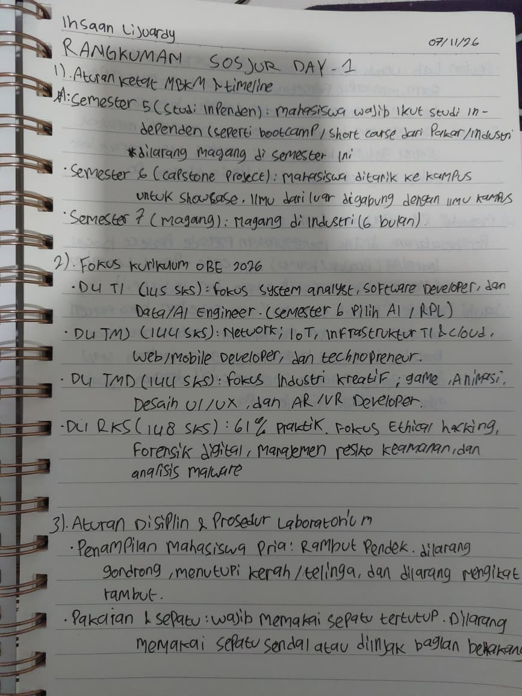

# Sosialisasi-Jurusan
Sosialisasi Jurusan Ihsaan Lijuardy CCIT1B

# **Apa itu Repository?**
Repository adalah tempat penyimpanan yang menyimpan dan mengelola berbagai file-file proyek dari sebuah perangkat lunak, jadi pengembang atau developer bisa menggunakan repositori untuk meyinmpan kode, dokumen file konfigurasi dan sebagainya dalam satu tempat yang bisa diakses dengan mudah dan cepat

# **Fungsi Repository**
1. Pusat Penyimpanan
   Semua file yang dibutuhkan di sebuah projek bisa disimpan di satu tempat, jadi memudahkan akses untuk semua anggota tim
   
2. **Kerjasama Tim**
   Developer bisa menggunakan repositori untuk bekerja pada projek yang sama tanpa kehilangan progres yang dibuat
   
3. **Backup**
   Kalau menggunakan repositori berbasis _Cloud_ , data proyek tetap aman walaupun perangkat lokal bermasalah

# **Dokumentasi**

.jpeg)

